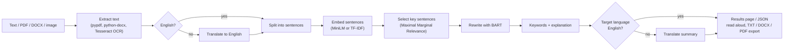

# RMTC Text Summarization

A Flask web app that summarizes text and documents and returns the summary in
one of 14 languages, with a focus on Indian languages (Kannada by default).

It uses a **hybrid** approach: it first *extracts* the most representative,
non-redundant sentences using multilingual sentence embeddings, then *rewrites*
them into a fluent summary with BART, and finally translates the result.

**Features**

- Input: pasted text, or multiple uploads (`.pdf`, `.docx`, `.txt`, `.png`/`.jpg` via OCR), each summarized separately
- Output languages: English, Kannada, Hindi, Bengali, Tamil, Telugu, Malayalam, Marathi, Gujarati, Punjabi, Urdu, Spanish, French, German
- Input in any of those languages (it is translated to English for summarization)
- Three summary styles: *simple*, *balanced*, *detailed*
- Keywords and an explanation of which sentences were selected and why
- Read-aloud (Google TTS, falling back to the browser's speech engine)
- Export to TXT, Word (.docx) and PDF (with proper Indic script rendering)
- JSON API (see [docs/API.md](docs/API.md))
- Works without any ML models in *lightweight mode*, and runs fully offline when models are installed and online services are disabled

---

## How it works



Every stage has a fallback (TF-IDF instead of MiniLM, extractive output instead
of BART, Google instead of local translation models), so the app keeps working
when a model, library or network connection is missing. Problems are shown
as warnings on the result rather than as errors.
**[docs/ARCHITECTURE.md](docs/ARCHITECTURE.md)** has detailed diagrams of each part.

---

## Requirements

- **[uv](https://docs.astral.sh/uv/)**, the Python package and project manager.
  uv also installs the right Python version (3.12, from `.python-version`) automatically.

  ```bash
  # Linux / macOS
  curl -LsSf https://astral.sh/uv/install.sh | sh
  # Windows (PowerShell)
  powershell -ExecutionPolicy ByPass -c "irm https://astral.sh/uv/install.ps1 | iex"
  ```

- **Optional system packages:**

  | Needed for | Linux (Debian/Ubuntu) | macOS | Windows |
  |---|---|---|---|
  | Image OCR (`.png`/`.jpg` uploads) | `sudo apt install tesseract-ocr` | `brew install tesseract` | [Tesseract installer](https://github.com/UB-Mannheim/tesseract/wiki), add to `PATH` |
  | Indic text in PDF export | `sudo apt install fonts-noto-core` | Download Noto Sans fonts into `./fonts` | Nothing: *Nirmala UI* ships with Windows |

  Without a suitable font, that script renders as blank boxes in the PDF and a warning is
  logged. The Word export is unaffected.

---

## Getting started

### 1. Install dependencies

```bash
git clone <repo-url> RMTC-text-summarization
cd RMTC-text-summarization

uv sync                  # core app (lightweight, ~150 MB)
# or
uv sync --extra ml       # + neural models: PyTorch, Transformers (several GB)
```

`uv sync` creates `.venv/` and installs exactly the versions pinned in `uv.lock`.
You don't need to activate the virtual environment, because `uv run` uses it automatically.

| Install | Summaries | Translation | Disk |
|---|---|---|---|
| `uv sync` | Extractive (TF-IDF + MMR) | Google Translate only (needs internet) | ~150 MB |
| `uv sync --extra ml` | Hybrid: MiniLM selection + BART rewrite | Offline NLLB-200 / Marian models, Google as fallback | ~3 GB packages + ~5 GB models |

> **GPU:** On Linux, PyPI's `torch` wheel includes CUDA support, and a GPU is used automatically
> when present. On Windows and macOS it is CPU-only (or Apple MPS). Expect tens of seconds per long document on CPU.

### 2. Download NLTK data (once)

```bash
uv run python -m nltk.downloader punkt punkt_tab stopwords
```

Optional: without it, a regex sentence splitter and a built-in stopword list are used.

### 3. Configure

```bash
cp .env.example .env        # Windows: Copy-Item .env.example .env
```

Then edit `.env`. Every option is documented in [`.env.example`](.env.example). For a first run:

- With only `uv sync`, set `LIGHTWEIGHT_MODE=true`.
- Set `FLASK_SECRET_KEY` to the output of `uv run python -c "import secrets; print(secrets.token_hex(32))"`.

### 4. Run

```bash
uv run app.py
```

The app starts on **http://127.0.0.1:5000/index** and opens your browser (turn that off
with `OPEN_BROWSER=false`). With the `ml` extra, the **first** summary downloads the models
into the Hugging Face cache (`~/.cache/huggingface`, or `HF_HOME`), so it takes a few minutes.
Later runs start immediately.

Stop the server with `Ctrl+C`.

---

## Using the app

1. Open http://127.0.0.1:5000/index.
2. Paste text and/or upload one or more files.
3. Choose the **output language** and **summary style**, then press **Submit**.
4. Each document gets its own card with the original text, the summary, keywords,
   an explanation, **Play / Stop** read-aloud and **TXT / Word / PDF / Copy** buttons.

Notes about a result appear on its card (for example "translation unavailable, showing
English"). Files that couldn't be read (scanned PDFs, OCR not installed) are listed at the top.

### API

```bash
curl -F text="Your long text here..." -F language=hi -F summary_mode=balanced \
     http://127.0.0.1:5000/api/summarize

curl -F files=@report.pdf -F files=@notes.docx -F language=kn \
     http://127.0.0.1:5000/api/summarize
```

See **[docs/API.md](docs/API.md)** for all endpoints, fields and error codes.

---

## Configuration

Settings come from environment variables, and are read from `.env` if present.
The most important ones:

| Variable | Default | Purpose |
|---|---|---|
| `FLASK_SECRET_KEY` | random per start | Signs session cookies. **Set it** for any shared deployment. |
| `HOST` / `PORT` | `127.0.0.1` / `5000` | Listen address. Use `0.0.0.0` to allow other machines to connect. |
| `AUTH_ENABLED` | `false` | Require login for the app and API. |
| `APP_USERNAME` / `APP_PASSWORD_HASH` | `admin` / empty | Login credentials (the password is stored only as a hash). |
| `LIGHTWEIGHT_MODE` | `false` | Skip all neural models. |
| `ENABLE_ONLINE_TRANSLATION` | `true` | Google Translate fallback. **Sends document text to Google.** |
| `ENABLE_ONLINE_TTS` | `true` | Google TTS for read-aloud. |
| `DEFAULT_LANGUAGE` / `DEFAULT_SUMMARY_MODE` | `kn` / `balanced` | Form defaults. |
| `MULTILINGUAL_MODEL` | NLLB-200 | Main translator for Kannada/Telugu/Tamil. **CC-BY-NC (non-commercial).** Set mBART-50 for commercial use; kn/te/ta then rely on Google. |
| `QUANTIZE_TRANSLATION` / `TRANSLATION_BEAMS` | `true` / `2` | Translation speed vs quality on CPU. See [Speed](docs/ARCHITECTURE.md#speed-cpu). |
| `PRELOAD_MODELS` | `true` | Load models in the background at startup so the first request is not slow. |
| `MAX_UPLOAD_MB` | `20` | Request size limit. |
| `PDF_FONT_DIR` | empty | Extra folder searched for TTF fonts. |

**Enabling login:**

```bash
uv run python -c "from werkzeug.security import generate_password_hash as g; print(g('choose-a-password'))"
```

Put the output in `.env` as `APP_PASSWORD_HASH=...` and set `AUTH_ENABLED=true`.

> **Privacy:** for confidential documents install with `--extra ml` and set
> `ENABLE_ONLINE_TRANSLATION=false` and `ENABLE_ONLINE_TTS=false`, so nothing leaves the machine.

---

## Development

```bash
uv sync --group dev                       # dev tools (pytest, pyflakes); included by default
uv run pytest                             # or: uv run python -m unittest -v test_app
uv run pyflakes *.py                      # lint
uv run run_translation_test.py kn         # manual end-to-end smoke test with your .env
```

The unit tests are **hermetic**: they force lightweight mode, disable online services and mock
translation, so they run in a couple of seconds with no downloads or network.

**Managing dependencies:**

```bash
uv add <package>                # add a core dependency (updates pyproject.toml and uv.lock)
uv add --optional ml <package>  # add to the ML extra
uv add --dev <package>          # add a dev tool
uv lock --upgrade               # upgrade all locked versions
```

**Without uv:** export a requirements file and use pip:

```bash
uv export --no-hashes --extra ml --no-dev -o requirements.txt
python -m venv .venv && source .venv/bin/activate && pip install -r requirements.txt
```

### Deployment

The built-in Flask server is for development only. Use a WSGI server, for example:

```bash
uv add gunicorn
uv run gunicorn -w 1 -t 300 -b 0.0.0.0:8000 app:app
```

Use one worker per GPU or per memory budget, because each worker loads its own copy of the models.
Set `FLASK_SECRET_KEY` and consider `AUTH_ENABLED=true`.

---

## Project structure

```
app.py                  Flask routes, auth, request handling
backend.py              Summarization, translation and text-extraction pipeline
exporter.py             PDF / DOCX export with per-script font selection
config.py               Settings loaded from the environment / .env
templates/              Jinja pages: home, login, index (input), summary (results)
static/                 CSS, images, static about/contact pages
test_app.py             Unit tests
run_translation_test.py Manual end-to-end smoke test
pyproject.toml          Project metadata and dependencies (core, ml extra, dev group)
uv.lock                 Locked dependency versions (commit this)
.python-version         Python version used by uv
.env.example            Documented configuration template
docs/                   Architecture and API documentation
BUGS.md                 Code-review findings and their status
glove.6B.100d.txt       GloVe vectors (Git LFS); not used by the current code
```

---

## Troubleshooting

| Symptom | Fix |
|---|---|
| "Translation to 'kn' is not available" warning | Install `--extra ml`, or enable `ENABLE_ONLINE_TRANSLATION` and check your internet connection. Google may rate-limit heavy use. |
| Indic text shows as boxes in the PDF | Install Noto fonts (see Requirements) or set `PDF_FONT_DIR`. Use the Word export meanwhile. |
| "has no extractable text (scanned PDF?)" | The PDF is an image scan. Export the pages as images and upload those (needs Tesseract). |
| "Image OCR is not available" | Install the Tesseract binary and make sure it is on `PATH`. |
| The first summary is very slow | Models are downloading (several GB). Later runs use the cache. |
| Out of memory | Set `LIGHTWEIGHT_MODE=true`, or use a machine with more RAM (about 8 GB is needed with all models). |
| Logged out after every restart | Set `FLASK_SECRET_KEY` in `.env`. |
| `413` error on upload | Raise `MAX_UPLOAD_MB`. |

---

## Known limitations

- **Urdu in PDF export:** ReportLab lacks right-to-left layout without the non-PyPI
  `rlbidi` package, so Urdu words may appear in the wrong order. Use the Word export for Urdu.
- **Translation quality** varies by language. Kannada, Tamil and Telugu use the multi-language
  `opus-mt-en-dra` model, and Bengali, Gujarati and Punjabi use `opus-mt-en-inc`.
- **Summarization is English-centric:** non-English input is translated to English first,
  so translation errors carry through to the summary.
